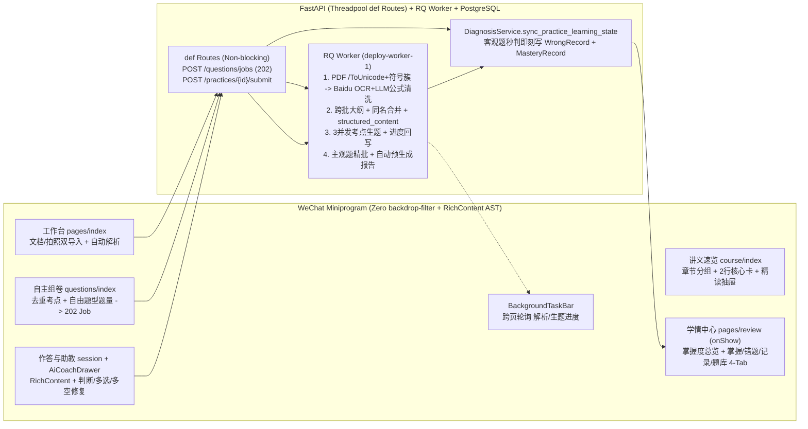

# Technical Design — 学习全流程重设计与移动端体验重构

## 1. End-to-End Architecture & Data Flow



## 2. Database & API Contract Extensions (Backward-Compatible)

### 2.1 Alembic Migration `0011_structured_kp_and_question_jobs.py`
1. **`knowledge_points` 表新增可空列**（旧数据零破坏，前端对旧数据自动降级读 `description`）：
   - `structured_content: JSON`（nullable）：
     ```json
     {
       "core_summary": "朴素贝叶斯假设给定类别下各特征条件独立，将联合条件概率转化为单特征条件概率连乘。",
       "key_takeaways": ["...", "..."],
       "key_formulas": ["P(Y=c_k | X=x) \\propto P(Y=c_k) \\prod_j P(x_j | Y=c_k)"],
       "boundary_notes": ["特征强相关或先验失真时分类准确率下降"]
     }
     ```
   - `sort_order: Integer`（default `0`，保持教材自然先后顺序）。
2. **`question_generation_jobs` 表（新建）**：
   - `id (UUID PK)`, `user_id (UUID FK, index)`, `material_id (UUID nullable)`, `folder_id (UUID nullable)`, `status (VARCHAR: queued | running | completed | failed)`, `request_payload (JSON)`, `total_kps (INT)`, `completed_kps (INT)`, `generated_count (INT)`, `batch_id (VARCHAR nullable)`, `question_ids (JSON default [])`, `error_message (TEXT nullable)`, `created_at`, `updated_at`, `completed_at`.
   - API 端点：
     - `POST /api/v1/questions/jobs` -> `202 Accepted` 返回 `QuestionGenerationJobResponse` 并投递 RQ（若 `queue.provider == "memory"` 则在后台守护线程执行或立即完成，兼容离线测试！）；
     - `GET /api/v1/questions/jobs?active_only=true` & `GET /api/v1/questions/jobs/{job_id}` -> 供前端全局任务条与出题页轮询。
     - 原 `POST /api/v1/questions/generate` 保持完整向后兼容，改为 `def` 线程池路由不再阻塞事件循环。

### 2.2 PDF Formula Garble Detection & Restoration (`core/extractors/` + `services/material.py`)
- 在 PDF 按页提取时，同时检查：
  1. 页面 `/Resources/Font` 中是否存在含数学/符号字体（如 `Symbol`, `MT-Extra`, `CambriaMath`, `Wingdings`）且缺失 `/ToUnicode` CMap；
  2. 文本质量检测器（`ocr_quality.py`）新增 `ascii_symbol_cluster_ratio`：连续 `>=2` 个非成对 ASCII 运算符/符号簇（如 `AB&A&`, `"#$"$`, `!" ! #`）占比超阈值（如 `> 0.03` 或出现 `>= 3` 处）即判定为 **字体映射损坏页**。
- **恢复路径**：
  - 若环境安装了 `pypdfium2`/`pymupdf` 可转 PNG 则调 `OCRProtocol`；若纯 `pypdf` 环境无位图渲染库，则对该页损坏片段调用 `LLMProtocol` 的**受控符号乱码清洗重建器**（保留原文完好中文骨架，将损坏的 `SymbolMT` 槽位依据前后文数学定义还原为标准可读公式标记或清除无意义乱码行，严禁编造原文未提概念），彻底阻断 `AB&A&` 污染切片与下游 `NO_SOURCE` 误杀！
  - 同时在 `POST /api/v1/materials/{id}/parse` 支持对已 `ready` 资料传 `?force=true` 重新解析，清理旧乱码切片与重复考点。

### 2.3 Zero-Dependency `<RichContent>` AST Engine (`miniprogram/src/utils/richText.ts`)
- 微信小程序原生 `<rich-text :nodes="nodes">` 支持标准受控 HTML 节点树（`div`, `p`, `span`, `strong`, `em`, `code`, `pre`, `ul`, `ol`, `li`, `sub`, `sup`, `blockquote`）：
  - 将 Markdown（`###`、`**bold**`、`- list`、`` `code` ``）与 LaTeX 数学表达式（`$...$`、`$$...$$`、`P(Y=c_k | X=x_j)`、`\frac{a}{b}`、`\sum`、`\prod`、`\alpha..\omega`、`\le/\ge/\ne/\approx/\propto/\in`）确定性解析为带内联样式的 `RichTextNode[]`；
  - 零外部 npm 包体积增量，避免 `mp-html` 等重型插件破坏编译与样式隔离；
  - 在 `CoachMessageList.vue` 中同时声明 `defineOptions({ options: { virtualHost: true } })`（UniApp `mp-weixin` 虚拟宿主节点规范）并给外层容器赋予确定高度计算，彻底解决 `scroll-view` 不滚动问题。

## 3. Non-Colliding Swarm Wave Plan

| Wave | Parallel Tracks (`workspace: "share"`) | Model Tier | Strict Path Ownership |
| --- | --- | --- | --- |
| **Wave 1 (Backend Foundation)** | `be-async-jobs` (1A) + `be-knowledge-pdf` (1B) + `be-grading-sync` (1C) + `verifier-w1` | `XHigh` (1B/1C) & `High` (1A/Verifier) | Disjoint `backend/` slices (1A: `api/v1` `def` + `question_generation_jobs` + `worker.py`; 1B: `extractors` + `ocr_quality` + `knowledge` model/dedup/structured; 1C: `practice`/`grading`/`diagnosis` sync hooks + `_question_llm_schemas`); Coordinator merges migrations cleanly if >1 |
| **Wave 2 (Frontend Core Engine)** | `fe-visual-coach` (2A) + `fe-richtext-contracts` (2B) + `verifier-w2` | `XHigh` | Disjoint `miniprogram/src` foundation slices (2A: `App.vue`, `styles/*`, `utils/loadingGuard.ts`, `stores/backgroundTask.ts`, `components/{BackgroundTaskBar,AiCoachDrawer,CoachMessageList}.vue`, `composables/useCoachChat.ts`; 2B: `utils/richText.ts`, `components/{RichContent,QuestionRichBody}.vue`, `types/*`, `api/*`) |
| **Wave 3 (8-Page Flow Integration)** | `fe-study-flow` (3A) + `fe-practice-review` (3B) + `verifier-w3` | `XHigh` | Disjoint page slices (3A: `pages/index/**` + `subpackages/material/pages/course/**`; 3B: `subpackages/material/pages/questions/**` + `subpackages/practice/**` + `subpackages/report/**` + `pages/review/**`), keeping all `.vue <= 300` lines |
| **Wave 4 (Main Session Verification & Docker Rebuild)** | Main Session + Live Smoke | — | `task verify` + `alembic upgrade head` + `pnpm run build:mp-weixin` + `docker compose up -d --build worker` reminder |
