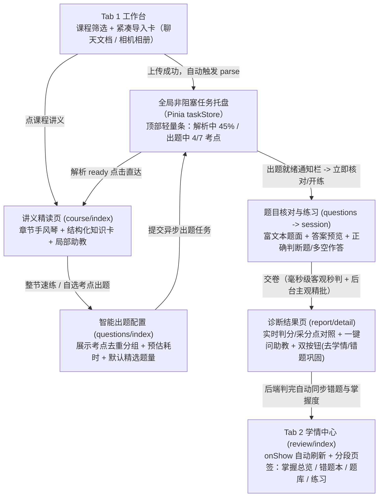

# 前端视觉层级、AI 助教、题目排版与全流程移动端体验重设计调研报告

## Executive Summary

1. **UI1 蒙版模糊、毛玻璃闪烁与 `showLoading` 告警根因**：`miniprogram/src/styles/modal.scss:10,25` 将 `backdrop-filter: blur(2px)` 错加在覆盖全屏且包含内容面板的父容器 `.modal-overlay`/`.sheet-overlay` 上（6 个浮层共享相同 `z-index: 999`），`common.scss:47` 的 `.bottom-fixed-bar` 加了 `backdrop-filter: blur(10px)` 却无 `z-index`。在 `mp-weixin` DevTools 下不仅使浮层内部文本/`<scroll-view>` 触发 GPU 重采样变糊，且 `course/index.vue`（含 `blur(10px)` 与同帧切换的 `blur(2px)` 抽屉）与 `questions/index.vue`（无 `backdrop-filter` 但连续触发 `showLoading`/`showToast`）之间的渲染切换导致毛玻璃闪烁。同时全仓 **11 处 `uni.showLoading`** 与 `request.ts:16,35,155,165` 的自动 `uni.showToast`（以及 `questions/index.vue:117-121` 先 toast 后 `hideLoading`）在微信单槽位原生提示机制下必然冲突，直接触发 `请注意 showLoading 与 hideLoading 必须配对使用`。
2. **UI2 AI 助教不可滚动、右侧裁切与裸 Markdown 根因**：`CoachMessageList.vue` 无 `virtualHost: true`（`CoachMessageList.json`），其宿主标签 `<coach-message-list>` 在 `AiCoachDrawer.vue` flex 列布局中未获 `flex: 1; min-height: 0`，且 `.chat-body`（`<scroll-view scroll-y>`）缺少 `height: 0` 约束，导致列表撑开而非滚动；更关键的是 `App.vue:103` 的 `box-sizing: border-box` 漏掉了 `scroll-view`（及 `textarea`），使 `.chat-body`（`padding: 24rpx 32rpx`）实际宽度变为 `100% + 64rpx`，右对齐用户气泡被推至视口右侧外 32rpx 遭裁切。`useCoachChat.ts:26` 全局复用单个 `messageList` 导致切换知识点/题目串台；回复直出 `<text>{{ msg.content }}</text>` 未解析 Markdown 与公式。
3. **题目排版错乱与跨端判题断链**：`_question_llm_schemas.py:67-72` 字典选项分支未剥离 `A.`/`A、` 前缀，与 `optionDisplayText` 叠加产生 `A. A.`；**高危跨层 Bug**：`session/index.vue:166-172` 对 `true_false` 写入 `'A'`/`'B'`，而 `grading.py:91-96,268-284,343-357` 仅认 `正确/错误/T/F`，导致所有判断题在前端作答均被判 0 分；`QuestionPreviewCard.vue` 隐藏答案/解析/采分点，`AttemptResultCard.vue` 漏渲染 `gradingPoints` 且选项无对错高亮，`fill_in_blank` 单框与多空 `;` 分隔脱节，多选题续练字符串未 `JSON.parse`。
4. **全流程与移动端重设计蓝图**：对比三套重设计方案后，推荐「**渐进式非阻塞学练一体流（方案 B）**」——工作台补齐拍照/相册导入与全局后台任务条（消除 90s 生题与 30s 轮询阻塞）；课程页改为「章节手风琴 + 一句话核心结论/公式标签/掌握度徽章 + 按需展开详情」取代 15 行文字墙；全站彻底移除 `backdrop-filter` 改用分层 Scrim 与实色阴影、`z-index` Token 阶梯与 `loadingGuard`；AI 助教与题目统一接入零依赖 `<rich-text :nodes>` AST 富文本与数学符号排版组件；学情 Tab 拆分为分段子视图（总览仪表盘 / 错题巩固 / 我的练习 / 我的题库）。

---

## 一、UI1：蒙版模糊、毛玻璃闪烁与 `showLoading` / `hideLoading` 配对告警根因

### 1.1 `backdrop-filter`、`z-index` 与复合层渲染缺陷清单

| 位置 (`file:line`) | 实际 CSS / 编译产物证据 | 引发的问题与机理 |
| :--- | :--- | :--- |
| `miniprogram/src/styles/modal.scss:3-16` | `.modal-overlay { position: fixed; inset: 0; background: var(--color-overlay); backdrop-filter: blur(2px); z-index: 999; }` | `backdrop-filter` 挂在**包含 `.modal-content` 的整屏父容器**上，且缺失 `-webkit-backdrop-filter`；WeChat DevTools Chromium WebView 在 `position: fixed` + `rpx` DPR 缩放下对其创建 Backdrop Root 纹理采样，触发父/子层模糊连坐与重绘发糊（"前端糊的要死"）。 |
| `miniprogram/src/styles/modal.scss:18-30` | `.sheet-overlay { position: fixed; inset: 0; background: var(--color-overlay-strong); backdrop-filter: blur(2px); z-index: 999; }` | 同上；且内含 `<scroll-view>`、`input`、`textarea` 等组件（已编译进 `dist/build/mp-weixin/components/AiCoachDrawer.wxss`、`KnowledgeSnippetModal.wxss`、`AnswerCardDrawer.wxss`、`GradingActionModal.wxss`、`FolderFormModal.wxss`、`ProfileEditModal.wxss` 共 6 份产物），滚动/聚焦时 Backdrop 纹理反复重栅格化，导致文字发虚。 |
| `miniprogram/src/styles/common.scss:38-50` | `.bottom-fixed-bar { position: fixed; bottom: 0; ... background: var(--color-bar-bg); backdrop-filter: blur(10px); }`（**无 `z-index`**） | 编译进 `dist/build/mp-weixin` 共 **15 份** `.wxss`（含 `pages/index/index.wxss`、`subpackages/material/pages/course/index.wxss`、`subpackages/report/pages/detail/index.wxss` 等）。因缺少 `z-index`，依赖 DOM 顺序叠放；且 `blur(10px)` 吸底栏在 DevTools 滚动/页面切换时与底层卡片抢占合成层。 |
| 6 个弹窗/抽屉全部共享 `z-index: 999` | `AiCoachDrawer.vue`、`KnowledgeSnippetModal.vue`、`FolderFormModal.vue`、`ProfileEditModal.vue`、`AnswerCardDrawer.vue`、`GradingActionModal.vue` 均使用 `modal.scss` 的 `999` | 无一级抽屉/二级弹窗层级差。在 `subpackages/material/pages/course/index.vue:80-88` 的 `askAboutPoint` 中，`course.showPointModal.value = false` 与 `showCoach.value = true` 在**同一 Vue tick** 同步切换两个 `z-index: 999; backdrop-filter: blur(2px)` 浮层，出现双蒙版帧重叠与闪烁。 |
| 固定底栏与浮标缺少层级契约 | `pages/index/index.vue:267` `.floating-coach-btn` 为 `z-index: 100`；`questions.scss:154` `.bottom-action-bar`、`session.scss:204` `.bottom-bar`、`report.scss:167` `.bottom-bar` **均无 `z-index`** | 主页右下角悬浮助教按钮在 `375pt` 小屏滚动时会压住末张 `MaterialItemCard` 的「删除」热区（`MaterialItemCard.vue:37`）；分包底栏无 `z-index` 易被后续定位元素穿透。 |
| 缺失显式 `transform` / `will-change` | `git grep` 显示全仓仅 `tokens.scss:40` 对勾有 `transform: rotate(-45deg)`，无动画 `transform` | 浮层以 `v-if="visible"` 硬切挂载/卸载，加剧单帧 Backdrop 合成器重建抖动。 |

### 1.2 为何「出题页一会儿有毛玻璃一会儿没有」

综合比对源码与编译产物（`subpackages/material/pages/course/index.vue`、`pages/questions/index.vue`、`questions.scss`），该现象由**两段链路叠加**造成：

1. **样式定义不对称与状态门控闪烁**：
   - 上游讲义详情页 `course/index.vue:19` 的 `.bottom-fixed-bar`（承载「按知识点组卷出题」按钮）继承 `common.scss:47`，带有 `backdrop-filter: blur(10px)`，且整条底栏受 `v-if="course.material.value?.status === 'ready'"` 控制——在轮询刷新期间会动态挂载/卸载；打开溯源弹窗/助教时又叠加 `modal.scss` 的 `blur(2px)`。
   - 下游组卷出题页 `questions/index.vue` 的配置态（`QuestionConfigPanel.vue`）**没有**固定底栏；核对态（`QuestionPreviewPanel.vue:35`）的 `.bottom-action-bar`（`questions.scss:154-164`）虽然也使用了 `background: var(--color-bar-bg)`（`rgba(255,255,255,0.95)`），却**没有** `backdrop-filter`（仅保留透明底色）。
2. **DevTools 合成器丢帧 + 原生 Loading 遮罩频繁闪现**：
   - 在 `questions/index.vue:69-80`（`onLoad`）中，若带 `view=generated` 参数进入，会连续串行执行 `loadKpFromMaterial`（`uni.showLoading`，第 97 行）→ `uni.hideLoading`（第 103 行）→ `loadGeneratedQuestions`（`uni.showLoading`，第 110 行）→ `uni.showToast`（第 117/119 行）→ `uni.hideLoading`（第 121 行）。
   - 同时，在 WeChat DevTools Windows WebView 中，`backdrop-filter` 合成层在页面栈返回/切入及原生 `wx.showLoading` 半透明蒙版盖层触发重绘时，常出现间歇性模糊失效与恢复，加之上述两页底栏毛玻璃有无不一致，表现为「一会儿有毛玻璃一会儿没有」。

### 1.3 全仓 `uni.showLoading` / `uni.hideLoading` 不配对全量审计（11 处调用点）

**核心机制根因**：在微信小程序运行时，`wx.showLoading` 与 `wx.showToast` **共用同一个全局原生弹窗槽位**。调用 `wx.showToast` 会立刻顶替并关闭正在显示的 `wx.showLoading`；此后业务侧再执行 `uni.hideLoading()`，不仅会**误杀刚弹出的错误 Toast**，还会因为此时已无活跃 Loading 而触发控制台警告：
`请注意 showLoading 与 hideLoading 必须配对使用`。

而本项目 `miniprogram/src/utils/request.ts` 在**传输层拦截回调里直接调用了 `uni.showToast`**：
- `request.ts:16`（`handleUnauthorized`，401 时弹 toast）
- `request.ts:35`（`reportFailure`，所有非 2xx HTTP 错误、`timeout`、`network` 错误时弹 toast）
- `request.ts:141,155,165`（`uploadFile` 同样自动弹 toast）

于是全仓 **全部 11 处 `showLoading` 调用点**在网络异常时均发生冲突，更有直接逻辑不配对点如下表：

| 序号 | 位置 (`file:line`) | 配对缺陷类型 | 精确触发路径 |
| :-: | :--- | :--- | :--- |
| 1 | `pages/index/index.vue:151-156` (`switchFolder`) | **无 `try/finally` + 传输层 Toast 抢占 + 并发竞态** | `switchFolder` 调 `showLoading`（153 行）→ `materialStore.loadMaterialList` 内部 `catch` 吞错返回 `[]`（`stores/material.ts:79-82`），但失败时 `request.ts:35` 已先弹 `showToast` 关掉了 loading，155 行再调 `hideLoading()` 必报不配对警告；此外从 `useFolderModal.ts:49-51` 新建课程后先 `showToast` 紧接调 `onSwitched` (`switchFolder`) 也会撞车；连续快切两个文件夹胶囊会产生 `show→show→hide→hide` 并发错位。 |
| 2 | `subpackages/material/pages/questions/index.vue:109-123` (`loadGeneratedQuestions`) | **代码路径自带必现不配对（即使 200 正常返回）** | 110 行 `showLoading`；当题库为空时 117 行先调 `uni.showToast('该讲义暂无已生成题目')`（或 119 行 `catch` 先调 `showToast`），随后 121 行 `finally` **再调 `uni.hideLoading()`**！100% 必报警告且瞬间吞掉 Toast。 |
| 3 | `pages/index/composables/useMaterialUpload.ts:17-27` | 传输层 Toast 抢占 + 无 `finally` 前置关闭 | `uploadFile` 失败时 `request.ts:155,165` 先 `showToast`，26 行 `catch` 再 `hideLoading()`；成功时 22 行 `showToast('上传成功')` 后立即 `onUploaded` 跳 `course/index`。 |
| 4 | `pages/index/index.vue:205-217` (`handleManualParse`) | 传输层 Toast 抢占 + 重复 Toast | 失败时 `request.ts:35` 已弹 Toast，214 行 `hideLoading()` 报不配对且关掉 Toast，215 行再补弹第二个 Toast。 |
| 5 | `subpackages/material/composables/useCourseDetail.ts:104-116` (`startParse`) | 同上 | 106 行 `showLoading`，失败时 `request.ts:35` 先弹 Toast，113 行 `hideLoading()` 冲突后 114 行再弹 Toast。 |
| 6 | `subpackages/material/pages/questions/index.vue:82-93` (`loadKpFromFolder`) | 传输层 Toast 抢占 | 84 行 `showLoading`，接口失败时 `request.ts:35` 先弹 Toast，90 行 `finally` 调 `hideLoading()` 误关 Toast 并告警。 |
| 7 | `subpackages/material/pages/questions/index.vue:95-106` (`loadKpFromMaterial`) | 传输层 Toast 抢占（store 吞错） | `materialStore.loadKnowledgeTree` 内部吞错（`stores/material.ts:100-103`），但 `request.ts:35` 已弹 Toast，103 行 `finally` 调 `hideLoading()` 必告警。 |
| 8 | `subpackages/material/pages/questions/index.vue:139-167` (`handleStartPractice`) | 传输层 Toast 抢占 + 重复 Toast | 139 行 `showLoading`，失败后 `request.ts:35` 先弹 Toast，163 行 `hideLoading()` 触发告警，164 行又弹 Toast。 |
| 9 | `subpackages/practice/pages/session/index.vue:228-242` (`confirmSubmit`) | 传输层 Toast 抢占 + 重复 Toast | 228 行 `showLoading`，`submit()` 失败后 `request.ts:35` 先弹 Toast，240 行 `hideLoading()` 告警且干掉 Toast（注：`draftQueue.flush()` 失败时未走 `request` 尚可，但 `apiSubmitPractice` 失败必冲突）。 |
| 10 | `subpackages/report/composables/useReportDetail.ts:67-76` (`bootstrap`) | 传输层 Toast 抢占 | 67 行 `showLoading`，失败时 `request.ts:35` 先弹 Toast，74 行 `finally { uni.hideLoading() }` 误关 Toast 并触发告警。 |
| 11 | `subpackages/report/composables/useReportDetail.ts:149-168` (`startAdaptivePractice`) & `pages/review/index.vue:228-241` (`runRegenerate`) | 传输层 Toast 抢占 + 重复 Toast | 均在 `showLoading` 期间请求 `/questions/generate`（同步等大模型易超时），`request.ts:35` 弹超时 Toast 后，业务 `catch` 调 `hideLoading()` 必触发不配对告警并重弹 Toast。 |

---

## 二、UI2：AI 助教抽屉不可滚动、右气泡裁切与富文本方案

### 2.1 `AiCoachDrawer.vue` 与 `CoachMessageList.vue` 核心缺陷定位

1. **为什么无法上下滑动（3 重阻塞叠加）**：
   - **自定义组件宿主缺失 Flex 弹性高度**：检查编译产物 `dist/build/mp-weixin/components/CoachMessageList.json` 仅为 `{"component": true, "usingComponents": {}}`（未配置 `"virtualHost": true`）。因此 `AiCoachDrawer.wxml:1` 中的 `<coach-message-list>` 在小程序节点树是一个真实存在的 `<coach-message-list>` 块级包裹标签；`CoachMessageList.vue:60` 的 `.chat-body { flex: 1; }` 作用在其内部子节点 `<scroll-view>` 上，**并未作用于 `.sheet-panel` 的直接子元素 `<coach-message-list>`**。宿主节点按内容高度自然撑开，超出 `75vh` 或把 `.drawer-footer` 顶出视野，`<scroll-view>` 本身高度等于内容总高，永远不触发滚动。
   - **`<scroll-view scroll-y>` 在 `mp-weixin` 缺少有限高度约束**：即使移除宿主隔离，`.chat-body` 只有 `flex: 1; overflow-y: auto;`（`CoachMessageList.vue:59-63`），缺少 `height: 0; min-height: 0;`（或外包 `view { flex: 1; min-height: 0; position: relative; }` + `<scroll-view style="height: 100%">`）。微信小程序 `<scroll-view>` 的原生滚动机制必须依赖**明确受限的盒高度**，`overflow-y: auto` 对 `<scroll-view>` 无效。
   - **缺少自动滚底锚点**：`CoachMessageList.vue:2` 未绑定 `:scroll-into-view` 与 `scroll-with-animation`，发送提问或流式/异步收到回复后不会自动定位到底部最新气泡。
   - *同类隐患附带发现*：`KnowledgeSnippetModal.vue:14,114-118` 的 `<scroll-view scroll-y class="sheet-body">` 同样仅写了 `flex: 1; padding: 28rpx 32rpx; overflow-y: auto;`，缺少 `height: 0; min-height: 0; box-sizing: border-box;`，在长切片下同样会高度失控并向右溢出。

2. **为什么右侧用户气泡被屏幕右边缘裁切**：
   - 检查 `miniprogram/src/App.vue:103-105`：
     ```css
     view, text, button, input {
       box-sizing: border-box;
     }
     ```
     全局重置**遗漏了 `scroll-view` 与 `textarea`**！
   - `CoachMessageList.vue:59-63` 为 `<scroll-view class="chat-body">` 设置了 `padding: 24rpx 32rpx`（且未写 `box-sizing: border-box`）。在默认 `content-box` 下，`.chat-body` 继承宽度 `100%`（750rpx）后再加上左右 `64rpx` 内边距，实际占用宽度变成 **`750rpx + 64rpx = 814rpx`**！
   - `modal.scss:49-57` 的 `.sheet-panel` 未设置 `overflow: hidden`，于是 `.chat-body` 向右溢出屏幕 `64rpx`；`.msg-user { justify-content: flex-end; }`（`CoachMessageList.vue:92-94`）将用户气泡贴紧 `.chat-body` 右内沿对齐，直接导致用户消息右侧 `32rpx~64rpx` 被屏幕右边界切掉。
   - 此外 `.msg-bubble`（`CoachMessageList.vue:100-105`）缺少 `word-break: break-word; overflow-wrap: anywhere;`，遇到长公式或英文标识符时会进一步撑宽气泡。

3. **对话状态跨上下文串台（UX 逻辑漏洞）**：
   - `useCoachChat.ts:26` 在组件内仅维护单一 `messageList = ref<ChatMessage[]>([])`，且未监听上下文 props 变化。
   - 在 `course/index.vue:39-45` 中点击考点 A 问助教，关闭后再点击考点 B 问助教或点击「讲义助教」；或在 `report/pages/detail/index.vue:61-68` 中对第 1 题问助教后再点第 2 题「问 AI 助教」，抽屉头部上下文变了，但消息区仍然残留上一题/上一考点的全部对话记录！

4. **AI 回复直出裸 `**bold**` 与 LaTeX 公式根因**：
   - `CoachMessageList.vue:10` 直接使用 `<text class="msg-text">{{ msg.content }}</text>`。
   - 后端 `QuestionService.ask_coach`（`backend/app/services/question.py:1126-1129`）与 `coach_graph.py:85-98` 均未约束纯文本输出，大模型常规输出 `**重点**`、`### 标题`、`- 列表`、`` `code` `` 及 `$P(Y=c_k | X=x_j)$` 等 LaTeX/下标表达式，前端原样显示裸符号。

### 2.2 零依赖 `mp-weixin` Markdown + 数学友好富文本渲染器设计

由于微信小程序不支持浏览器 DOM，且包体积受限（主包 `<= 2.0 MB`），同时 `<rich-text :nodes="...">` 在 `mp-weixin` 原生支持结构化 JSON AST（比传 HTML 字符串更安全、零 XSS 注入风险、且可单测），建议实现一个**纯 TypeScript、零第三方依赖**的轻量 AST 转换模块 `src/utils/richText.ts` + 共享渲染组件 `src/components/RichContent.vue`。

1. **渲染目标结构（`RichTextNode[]`）与 `mp-weixin` `<rich-text>` 白名单兼容**：
   - 块级节点映射：`h1~h4` → `<div class="rt-h">`；段落 `p` → `<div class="rt-p">`；无序/有序列表 `ul/ol` + `li` → `<div class="rt-list"><div class="rt-li">`（用统一圆点/数字前缀可控对齐，避开微信基础库原生 `ul/ol` 默认缩进过大问题）；引用 `blockquote` → `<div class="rt-quote">`；代码块 `pre > code` → `<div class="rt-code-block"><code>`；公式块 `$$...$$` / `\[...\]` → `<div class="rt-math-block">`。
   - 行内节点映射：`**bold**` / `__bold__` → `<strong>`；`*italic*` → `<em>`；`` `inline` `` → `<code class="rt-inline-code">`；行内公式 `$...$` / `\(...\)` → `<span class="rt-math-inline">` 配合 `<sub>` / `<sup>` 标签。
   - **数学公式友好清洗管线（`normalizeMathToRichNodes`）**：
     - 识别块级 `$$...$$` / `\[...\]` 与行内 `$...$` / `\(...\)`，以及无 `$` 包裹但含常见表达式的片段（如 `P(Y=c_k | X=x_j)`、`x_{i}`、`a^{2}`）：
     - **希腊字母与算符映射表**：`\alpha→α`, `\beta→β`, `\gamma→γ`, `\theta→θ`, `\lambda→λ`, `\mu→μ`, `\sigma→σ`, `\Sigma→Σ`, `\sum→∑`, `\prod→∏`, `\times→×`, `\cdot→·`, `\div→÷`, `\pm→±`, `\le/\leq→≤`, `\ge/\geq→≥`, `\neq→≠`, `\approx→≈`, `\in→∈`, `\notin→∉`, `\subset→⊂`, `\cup→∪`, `\cap→∩`, `\to/\rightarrow→→`, `\Rightarrow→⇒`, `\infty→∞`, `\sqrt{x}→√(x)`；
     - **分式降维**：`\frac{A}{B}` → `(A)/(B)`（单原子直接 `A/B`，嵌套或长表达式自动加括号），保留清晰可读性而不依赖 WebAssembly/KaTeX 体积；
     - **上下标真渲染**：解析 `_{...}` / `_x` 为 `{ name: 'sub', children: [...] }`，解析 `^{...}` / `^2` 为 `{ name: 'sup', children: [...] }`（微信小程序 `<rich-text>` 原生支持 `sub` / `sup` 标签，可用 `font-size: 0.75em; vertical-align: sub/super` 精确控制！）。
     - **残留转义剥离**：剥离 `\text{...}`、`\mathrm{...}`、`\mathbf{...}`、`\left` / `\right`、`\,` / `\;` 等 LaTeX 修饰宏，只留语义内容。
2. **交互元件与 `<rich-text>` 隔离原则**：
   - `<rich-text>` 内部子节点在 `mp-weixin` 中**无法触发单标签 `@tap`**（如引用角标或追问建议）。因此 `CoachMessageList.vue` 中：`msg.content` 正文与 `msg.prompt` 走 `<RichContent :content="msg.content" />`，而 `msg.suggestions`（追问胶囊）与 `msg.sources`（教材来源切片）仍由外层原生 `<view @tap>` 渲染。

### 2.3 AI 助教抽屉 UI/UX 重设计蓝图

1. **布局与组件结构修复**：
   - `CoachMessageList.vue` 开启 `defineOptions({ options: { virtualHost: true } })`（UniApp Vue3 编译为 `mp-weixin` 原生支持），或在宿主上强制 `flex: 1; min-height: 0; display: flex; flex-direction: column;`。
   - 外层包裹 `<view class="chat-scroll-wrap">`（`flex: 1; min-height: 0; width: 100%; overflow: hidden;`），内层 `<scroll-view scroll-y :scroll-into-view="bottomAnchorId" scroll-with-animation class="chat-body">`（`height: 100%; width: 100%; box-sizing: border-box;`），**内边距移至 `<view class="chat-inner">`（`padding: 24rpx 28rpx`）**，彻底根除 `scroll-view` 盒模型加宽导致的用户气泡右边缘裁切。
2. **多上下文会话隔离（解决串台）**：
   - `useCoachChat` 按唯一 `sessionKey`（优先级：`q:${questionId}` > `kp:${knowledgePointId}` > `mat:${materialId}` > `folder:${folderId}` > `global`）在 `Map<string, ChatMessage[]>` 中分别缓存最近对话，并在顶部提供「清空本段对话」轻按钮。
3. **375pt 移动端体验升级**：
   - **可折叠上下文条**：将原来的大块虚线框 `context-card` 改为吸顶单行折叠胶囊（默认截断 1 行，点击展开查看完整题干/考点摘要）。
   - **空态冷启动引导**：无消息时展示 3–4 个场景化破冰问题芯片（例如题目模式：「这道题为什么不选其他项？」「帮我梳理本题考点」「用大白话举例解释」；讲义模式：「总结本节核心公式」「哪些内容最容易出简答题？」），点击直接发出。
   - **消息操作增强**：AI 气泡底部增加极简「复制解析」按钮；失败消息在用户气泡旁显示红色 `! 重发` 按钮，不再污染 AI 对话流。
   - **引用来源降噪**：`msg.sources` 默认折叠为紧凑芯片「引用教材 2 处原文 ▾」，点击原地展开切片正文并支持跳转对应讲义。
   - **多行输入与键盘避让**：底部输入区改用 `<textarea auto-height :maxlength="500" :cursor-spacing="20" :adjust-position="true" />`（最多撑高至 4 行），避免长追问在单行 `<input>` 中横向滚屏看不全。

---

## 三、题目显示排版错乱与跨端判题断链全量根因

通过联查前端 4 处题目展示/作答组件、适配器层及后端 `QuestionService` / `grading.py` / `practice.py`，定位出 **7 项明确导致排版错乱与功能失效的根因**：

| 序号 | 问题现象 | 前端代码锚点 | 后端 / 跨层代码锚点 | 精确机制 |
| :-: | :--- | :--- | :--- | :--- |
| 1 | **选项双前缀 (`A. A. ...`)** | `src/api/adapters/question.ts:185-187` (`optionDisplayText`) | `backend/app/services/_question_llm_schemas.py:53-75` (`_normalize_llm_options`) | `_normalize_llm_options` 仅在 LLM 返回 `list[str]` 时剥离 `A.`/`A、` 等前缀（且漏了 `A)`/`(A)`/`A．`）；当 LLM 按 Prompt 要求（`_question_generation.py:189`）返回 `list[dict]` 时，**完全不清洗 `content` 里的自带编号**，也不清洗 `key` 尾随点号。前端 `optionDisplayText` 再无条件拼 `${key}. ${content}`，导致界面出现 `A. A. 贝叶斯定理...`。 |
| 2 | **判断题前端作答恒判 0 分且对照错位（高危）** | `subpackages/practice/pages/session/index.vue:40-47,166-172`；`AttemptResultCard.vue:18-19` | `backend/app/core/algorithms/grading.py:91-96,268-284,343-357` | `session/index.vue` 中 `scopeOptions` 为 `true_false` 构造 `{ key: 'A', content: '正确' }, { key: 'B', content: '错误' }`，点选后把 **`'A'` / `'B'`** 作为 `user_answer` 存库；而后端 `grading.py` 的 `TRUE_BOOLEAN_VALUES`/`FALSE_BOOLEAN_VALUES` 只认 `正确/错误/对/错/T/F/TRUE/FALSE/1/0/Y/N/V/X`，`normalize_boolean_answer('A')` 返回 `None`！结果**所有判断题全部判 0 分**（`"判断题作答无法解析为有效真假值"`），且报告页展示「你的作答：`A` / 标准答案：`正确`」。 |
| 3 | **核对页隐藏核心要素、报告页漏渲染采分点** | `QuestionPreviewCard.vue:1-35`；`AttemptResultCard.vue:22-40` | `backend/app/schemas/question.py:106-109`；`adapters/practice.ts:109` | `QuestionPreviewCard` 只渲染 `stem`、`options`、`source_quote`，**完全不显示参考答案 `answer`、解析 `analysis` 与主观题 `grading_points`**，用户在「核对出题」环节根本无法核对答案质量；`AttemptResultCard` 虽从适配器拿到了 `result.gradingPoints`，却**从未在模板中渲染**。 |
| 4 | **报告页选项区与答案对比区混糊** | `AttemptResultCard.vue:10-20,103-106` | — | 报告页直接把选项塞进灰色 `.answer-compare-box`（`font-size: 24rpx`），与紧邻的「你的作答 / 标准答案」同框同样式，既没有高亮用户选了哪项、哪项是正确答案，也无选项圆标，视觉上像两段重复文字墙。 |
| 5 | **多选题答案格式不统一 + 续练恢复失灵** | `AttemptResultCard.vue:18-19`（`formatAnswer`）；`session/index.vue:182-185`；`adapters/practice.ts:61-65` | `backend/app/schemas/practice.py:25-46,461-462`；`backend/app/services/practice.py:87-88` | 交卷/暂存时后端将多选数组存为 JSON 字符串 `'["A","C"]'`，`PracticeItemDetailResponse` 原样下发字符串；前端 `adaptPractice` 未做 `JSON.parse`，续练时 `isMultipleSelected`（校验 `Array.isArray`）恒为 `false`。报告页用户答案显示 `A、C`，标准答案却直出后端原串（可能是 `A,C` 或 `AC`）。 |
| 6 | **填空题单框硬怼多空 + 答案分隔符裸露** | `session/index.vue:72-80`；`AttemptResultCard.vue:19` | `backend/app/core/algorithms/grading.py:99-100,360-410` | 后端按 `;`、`；`、`&&` 切分多空，按 `\|`、`///`、`\|\|` 匹配等价答案；前端作答页却只给一个单行 `<input>` 且无分隔提示，报告页直接把含 `;` / `\|\|\|` 的标准答案原文打印出来。题干内下划线占位（`___` / `(  )` / `【】`）未做视觉强调。 |
| 7 | **题干/来源乱码直出 + 考点名缺失与误标** | `session/index.vue:28`；`WrongRecordCard.vue:4,41-44`；`QuestionPreviewCard.vue:11,25`；`QuestionBankQuestionRow.vue:13` | `backend/app/models/practice.py:132-147` (`build_question_snapshot`)；`schemas/practice.py:188-248` | ① 全站所有题干、解析、切片均用裸 `<text>`（无 `white-space: pre-wrap`、无 Markdown/公式清洗，且直接展示含 PDF 字体乱码的 `source_quote`）；② `session/index.vue:28` 读取 `currentQuestion.knowledge_point`，但后端快照只含 `knowledge_point_id` 不含名称，导致该徽章永久不显示；③ `WrongRecordCard.vue:41-44` 把 `questionTypeLabel` 塞进 `.kp-tag` 样式块，且既不展示所属考点名也不展示错作答/解析。 |

---

## 四、全站 8 页面现状流转图、375pt 痛点与产品重设计方案

### 4.1 现状 8 页面流转链路与 UX 断点图

```mermaid
flowchart LR
  L["pages/auth/login<br/>微信登录"] -->|"switchTab"| W["Tab 1: pages/index/index<br/>工作台（课程筛选/上传/列表/悬浮AI）"]
  W -->|"wx.chooseMessageFile 仅聊天文档<br/>(mp-weixin 屏蔽了相册/拍照)"| U["上传成功即跳转<br/>(未自动解析)"]
  U -->|"id=<materialId>"| C["subpackages/material/pages/course/index<br/>资料详情（手点开始解析 + 轮询30s）"]
  C -->|"扁平 10-15 行文字墙卡片"| KM["KnowledgeSnippetModal<br/>(z-index:999, blur 2px)"]
  KM -->|"同 tick 关弹窗开抽屉"| AI["AiCoachDrawer<br/>(不可滚动/右裁切/串台/裸MD)"]
  C -->|"点击组卷出题"| Q["subpackages/material/pages/questions/index<br/>核对出题（同步阻塞90s!）"]
  W -->|"课程全景刷题"| Q
  Q -->|"选考点(含同名重复) -> 阻塞生题 -> 核对 -> 开始作答"| P["subpackages/practice/pages/session/index<br/>练习作答（单题页+答题卡）"]
  P -->|"交卷 redirectTo"| R["subpackages/report/pages/detail/index<br/>诊断报告（轮询50s，仅返工作台）"]
  R -->|"必须全判完且停留才落库错题/掌握度"| TAB2["Tab 2: pages/review/index<br/>学情（无 onShow 刷新，4块巨型瀑布流）"]
  TAB2 -->|"错题再生/题库重练"| P
  W -.->|"TabBar"| TAB3["Tab 3: pages/profile/index<br/>个人中心（仅3项静态计数）"]
```



**375pt 屏幕高频痛点汇总**：
1. **上传与解析断点**：`useMaterialUpload.ts:35-51` 在 `#ifdef MP-WEIXIN` 分支调用 `wx.chooseMessageFile` 后直接 `return`，导致用户**无法从手机相册/相机拍讲义上传**（与 `retake_required`「请重新拍摄后上传」文案自相矛盾）；上传后跳到 `course/index` 还要再手动点一次「开始解析」，且 `index.vue:212` 仅在页内轮询 `20 × 1.5s = 30s`，离开页面即丢失解析进度感知。
2. **精读界面信息过载**：`KnowledgePointList.vue` 在 `375pt`（750rpx）宽屏上将 10–15 行纯文本直接铺满卡片，一屏仅容 1.5~2 张卡片，无章节折叠、无重点高亮、无掌握度标识、无「未学/已掌握」区分。
3. **生题等待黑洞与重复考点**：`useComposeConfig.ts:46` 默认全选所有考点，`plannedCount = max(selectedKpIds.length, questionCount)` 在多考点下静默把 5 题放大到 15–20 题；90 秒同步等待无后台任务托盘，离开即前功尽弃。
4. **报告页到学情 Tab 的路径断裂**：`report/detail/index.vue:49-51` 底栏只有「返回工作台」，虽然文案写「可稍后从学情页查看」，却无一键直达 `pages/review/index` 的入口。
5. **学情 Tab 信息失焦**：`pages/review/index.vue` 无分段 Tab，将「概览统计 + 我的题目（含全部批次折叠树） + 我的练习 + 错题巩固」硬塞在单一纵向页面，首屏被批次勾选框占满，既看不到「知识掌握度地图/薄弱点雷达」，全对练习后错题区又只显示「没有错题」。

---

### 4.2 三套全流程产品重设计方案对比

| 评估维度 | 方案 A：极简克制微调（Minimal Patch） | **方案 B：渐进式非阻塞学练一体流（推荐）** | 方案 C：全动态仪表盘重构（Heavy Dashboard） |
| :--- | :--- | :--- | :--- |
| **核心定位** | 保留现有 8 页与交互骨架，仅修 Bug 与补局部组件 | **不增删现有 8 页路由框架**，重构每页信息层级 + 新增全局非阻塞后台任务条 + 知识结构化精读与分段学情中心 | 拆改 TabBar 为「首页-学习-题库-学情-我的」，引入课程主页独立页面与复杂学习计划日历 |
| **跨页面任务流** | 仍为页内阻塞等待或局部轮询 | **上传即自动解析 + 全局悬浮/吸顶后台任务条**（同时承接「文档解析」与「异步出题」），用户可自由切页浏览讲义或刷已有题 | 全量消息中心页面 + WebSocket 推送 |
| **知识点展示架构** | 仅截断 `node-desc` 为 3 行省略 | **章节手风琴 + 精读卡片（1 句核心摘要 + 公式/考点标签 + 掌握度状态 + 快捷单点出题）**，点击展开结构化要点与可控原文抽屉 | 强行上 SVG/Canvas 力导向知识图谱（375pt 窄屏难触控、易卡顿） |
| **学情 Tab 组织** | 保留 4 块纵向堆叠，仅补充 `onShow` | **顶部掌握度总览卡 + 分段控制器（`掌握地图 \| 错题本 \| 我的题库 \| 练习历史`）**，单屏聚焦一项任务 | 多级嵌套子页面跳转 |
| **研发代价与风控** | 工期极短（2-3 天），但无法解决「文字墙」「学情大瀑布流」「等待焦虑」 | **工期可控（与异步生题/结构化知识后端演进完全对齐）**，符合 `DESIGN.md` 单 `.vue <= 300 行` 与 `<= 2MB` 主包红线 | 周期翻倍，路由重构易破坏既有测试与包体预算 |

**推荐结论**：坚定采用 **方案 B（渐进式非阻塞学练一体流）**。在不打破现有 8 页面路由契约与 3-Tab 架构的前提下，逐一解决全部实测痛点并构建完整产品闭环。

---

### 4.3 三大核心模块重设计蓝图（面向 375pt 手机端）

#### 蓝图 A：全链路非阻塞学习闭环（Flow Blueprint）



关键流转规则修正：
1. **资料导入合并拍照与微信文档（修复 `useMaterialUpload.ts:35-51`）**：点击导入弹出原生 `uni.showActionSheet(['从微信聊天选择文件 (PDF/DOCX)', '拍照或从相册选择讲义图片'])`；上传后默认**自动派发一次解析**（失败或需要重拍才留手动重试按钮），用户不必二次进详情页再点「开始解析」。
2. **非阻塞任务全局感知**：将解析轮询与异步生题任务上移至全局 `useBackgroundTaskStore`（或 `material` + `questionJob` store），在工作台、讲义详情、学情页顶部渲染一条非阻塞紧凑进度条（`height: 68rpx`），支持后台生成期间自由切换页面，就绪后提供「立即查看 / 开始核对」单点跳转。
3. **出题默认策略防爆炸（修复 `useComposeConfig.ts:46`）**：不再默认全选全部考点并抬高题量；若 `kpCount > 5`，默认推荐勾选**未掌握/薄弱考点**或前 5 个核心考点（并提供「全选 / 仅选未测考点」快捷胶囊），同时把去重与所属资料标签直接附在分组标题下，避免同名胶囊并排混淆。

#### 蓝图 B：移动端结构化知识卡片与知识树 UX

针对 `KnowledgePointList.vue` 10–15 行纯文本墙与 `KnowledgeSnippetModal.vue` 的阅读体验缺陷，按**三级渐进披露（Progressive Disclosure）**重构：

1. **第一级：章节手风琴目录（Chapter Accordion）**：
   - 将当前扁平 `nodes`（`KnowledgePointList.vue`）按 L1 根节点（或 `chapter_title`）分组为可折叠章节头：`章节标题 + 考点数量 + 章节平均掌握度条`；默认仅展开第 1 章（或含薄弱点的章节），其余折叠，单屏可一览全讲义骨架。
2. **第二级：高扫读性知识精读卡（Collapsed Card，单卡高度控制在 ~160–200rpx）**：
   - **顶栏（1 行）**：层级徽章（`L1/L2`） + 考点名称 + 右侧**掌握度状态胶囊**（`未练习` 灰 / `薄弱 32%` 红 / `巩固中 68%` 琥珀 / `已掌握 90%` 绿）。
   - **核心区（<= 2 行）**：展示 `core_summary`（后端新字段缺省时前端智能提取首句 <= 48 字作为摘要，严格 `2 行省略`），下方最多排布 **2–3 个轻量标签**：如含核心公式则展示 `含核心公式`、关联易错点数量等。
   - **快捷操作位（右侧/底栏轻量）**：`精读与溯源`（展开/抽屉）与 `测这一条`（直达该考点出题）。
3. **第三级：精读详情抽屉（`KnowledgePointSheet`）**：
   - 分区清晰、全部接入 `<RichContent>` 富文本与数学渲染：
     1. **核心结论**：浅蓝学术卡高亮 1–2 句本质定义；
     2. **关键要点 & 核心公式**：分条 `bullet` + 独立公式块卡（带等宽/清晰上下标排版）；
     3. **常见易错点**：琥珀提示块（若无则隐藏）；
     4. **教材原文溯源（默认折叠为页码胶囊）**：`查看第 6、7 页原文切片 (2 处) ▾`，避免未经清洗的长切片噪音抢占首屏，同时保留完整审计溯源能力；
     5. **吸底双按钮**：`问 AI 助教（针对此考点）` + `生成 3 道巩固题`。

#### 蓝图 C：弹窗/抽屉视觉与层级规范（彻底消灭 `backdrop-filter` 糊屏与闪烁）

1. **零 `backdrop-filter` 视觉体系（`src/styles/modal.scss` & `common.scss`）**：
   - **全面删除 `.modal-overlay`、`.sheet-overlay` 与 `.bottom-fixed-bar` 上的 `backdrop-filter: blur(...)`**。
   - 替代方案（温润学术纸质风高清晰度方案）：
     - 遮罩层（`.modal-backdrop`）：采用纯色半透明暗色 Scrim：`rgba(28, 25, 23, 0.48)`（居中弹窗）与 `rgba(28, 25, 23, 0.42)`（底部抽屉），在暖墨色基调上提供干净对比度，**零 GPU 模糊采样损耗，DevTools 与真机 100% 锐利**。
     - 浮层面板（`.modal-content` / `.sheet-panel`）：实色纸白 `#FFFFFF` + 顶边 1px 高光边框 `--color-paper-border` + 多层柔和投影 `0 -12rpx 36rpx rgba(28, 25, 23, 0.12)`，底部抽屉顶部增加 `72rpx × 8rpx` 拖拽把手指示条（`--color-border-strong`）。
     - 吸底栏（`.bottom-fixed-bar` / `.bottom-action-bar` / `.bottom-bar`）：改用高不透明度实色/微渐变底 `#FFFFFF`（或 `rgba(255, 255, 255, 0.98)`）+ 1px 顶边框 + 上向轻投影 `0 -6rpx 20rpx rgba(28, 25, 23, 0.05)`，**所有页面表现 100% 一致，不再出现「出题页一会儿有毛玻璃一会儿没有」**。
2. **统一 `z-index` Token 阶梯（写入 `App.vue` 全局 Token）**：
   - `--z-sticky: 20`（吸顶分段栏、后台任务条）
   - `--z-bottom-bar: 40`（所有页面 `.bottom-fixed-bar` / `.bottom-action-bar` / `.bottom-bar`）
   - `--z-fab: 60`（全局悬浮入口）
   - `--z-sheet-primary: 200`（一级底部抽屉：`KnowledgeSnippetModal`、`AnswerCardDrawer`）
   - `--z-sheet-coach: 300`（AI 助教抽屉 `AiCoachDrawer`，允许从知识点详情滑出时覆盖在上方或平滑切换）
   - `--z-modal: 400`（居中确认/表单弹窗：`FolderFormModal`、`ProfileEditModal`、`GradingActionModal`）
   - **安全同帧切换**：`course/index.vue` 的 `askAboutPoint` 若先关闭 `showPointModal` 再打开 `showCoach`，使用 `nextTick` 或赋予 `AiCoachDrawer` 独立更高层 `--z-sheet-coach: 300`，避免同层抢占。
3. **`loadingGuard` 与非阻塞加载规范（彻底清零 `showLoading` 配对警告）**：
   - **列表筛选与页面首刷禁用全屏原生 `uni.showLoading`**：如 `pages/index/index.vue:153`（`switchFolder`）、`questions/index.vue:84,97`（加载考点）、`report/detail`（`bootstrap`）改用**页面内骨架占位/局部 loading 状态**，用户可随时点击切换而不被原生黑框锁死。
   - **阻断型写操作统一走 `withBlockingLoading(title, asyncFn)`**：内部维护全局引用计数与状态标记，在 `finally` 中先保证执行 `hideLoading()`（且仅在当前确实由它持有活跃 loading 时），再在下一微任务弹出成功/错误 `showToast`；同时 `request.ts` 增加 `silentToast?: boolean` 参数，由 `withBlockingLoading` 接管失败提示或保证先关 loading 再弹 toast，**彻底消除「Toast 顶掉 Loading 后 `hideLoading` 告警并误杀 Toast」的死循环**。

---

### 4.4 题目通用展示体系重构（`QuestionCard` 家族）

统一抽出共享题目富文本展示单元，覆盖 **预览核对、沉浸作答、逐题报告、错题卡片、题库列表** 五大场景：

1. **数据归一化（前后端对齐）**：
   - 后端 `_normalize_llm_options`（`_question_llm_schemas.py:53-75`）与前端 `adaptQuestion`（`adapters/question.ts`）双重清洗选项 `key`（去掉尾随 `.`/`:`）及 `content`（剥离 `^[A-Z][\.\、\:\)\）\s]+` 或 `^\([A-Z]\)\s*`）。
   - **修复 `true_false` 跨端判题**：`session/index.vue` 中 `true_false` 提交语义值 `'正确'` / `'错误'`（展示仍可为直观双大卡片「正确 / 错误」），`AttemptResultCard.vue` 将历史 `'A'`/`'B'` 或 `'正确'`/`'错误'` 映射为清晰中文，不再出现 `你的作答：A`。
   - **修复多选题恢复与展示**：`adaptPractice` 对 `user_answer` 若为 JSON 数组字符串（`'["A","C"]'`）执行安全 `JSON.parse`；前端统一将单/多选答案规范化为有序字母配列（`A、C`）。
   - **修复填空题交互与展示**：检测 `stem` 占位空数或 `answer` 分隔符（`;` / `；` / `&&`），自动渲染对应数量的多格 `<input>`（提交时以 `; ` 合并），并在报告页把 `|||` 等价答案友好渲染为 `答案一（或 答案二）`。
   - **快照补齐 `knowledge_point_name`**：后端 `build_question_snapshot` 或响应 DTO 补齐 `knowledge_point_name`（前端向后兼容），让作答页与 `WrongRecordCard` 真正确切显示考点名称而非错把题型放进 `.kp-tag`。
2. **四场景视觉统一**：
   - **题干**：统一经 `<RichContent>` 渲染，填空占位符渲染为带底线高亮空位槽；保留换行（`white-space: pre-wrap`）。
   - **预览核对卡 (`QuestionPreviewCard.vue`)**：新增可折叠「参考答案 · 解析 · 采分点」核对区（默认折叠首行显示答案摘要，一键展开全部解析与 Rubric 分值明细），让「核对」名副其实。
   - **报告逐题卡 (`AttemptResultCard.vue`)**：选项各自独立成行，左侧放置圆形选项标（选对绿色勾、选错红色叉、漏选虚线蓝框），与下方「你的作答 / 标准答案」及「采分点命中明细（绿色已命中 / 红色遗漏）」形成清晰对比；教材依据切片改为可折叠引用块。

---

## 五、已核查 `.trellis/spec/` 规范文件清单（供 `implement.jsonl` / `check.jsonl` 编排）

本次只读调研核查了以下工程规范与契约文档，后续 Phase 2 实现与验收请按需精确引用：

- `D:/code/Workspace/zhilian/.trellis/spec/frontend/index.md`（前端整体架构、8 页面与 24 组件盘点、零 Emoji/Token 红线）
- `D:/code/Workspace/zhilian/.trellis/spec/frontend/component-guidelines.md`（Vue 3 SFC 规范、`defineProps`/`defineEmits` 约定、知识树禁止递归渲染、注：该文档中 300 行偏离与裸 Hex 历史备注已于 `frontend/index.md` 2026-11-17 清零记录中更新）
- `D:/code/Workspace/zhilian/.trellis/spec/frontend/quality-guidelines.md`（ESLint / `vue-tsc` / Vitest 门禁、`@tap.self` 小程序编译器丢弃铁律、`v-if` 写点校验、草稿串行与幂等契约）
- `D:/code/Workspace/zhilian/.trellis/spec/frontend/network-contract.md`（`DEFAULT_REQUEST_TIMEOUT_MS=15000` / `LONG_REQUEST_TIMEOUT_MS=90000` 两档超时与 `RequestError` 契约）
- `D:/code/Workspace/zhilian/.trellis/spec/frontend/type-safety.md`（`Wire*` 与领域 view 类型归一化边界）
- `D:/code/Workspace/zhilian/.trellis/spec/frontend/api-payload-contracts.md`（写入接口载荷语义）
- `D:/code/Workspace/zhilian/.trellis/spec/frontend/state-management.md`（5 个 Pinia store 状态与网络边界）
- `D:/code/Workspace/zhilian/.trellis/spec/frontend/directory-structure.md`（主包与 3 个分包目录划分）
- `D:/code/Workspace/zhilian/.trellis/spec/frontend/hook-guidelines.md`（composables 组织规范）
- `D:/code/Workspace/zhilian/.trellis/spec/guides/cross-layer-thinking-guide.md`（前后端字段名/序列化对齐思维指南——覆盖本次发现的 `true_false` 传值与多选 JSON 恢复问题）
- `D:/code/Workspace/zhilian/.trellis/spec/guides/code-reuse-thinking-guide.md`（共享渲染与工具抽离指南）
- `D:/code/Workspace/zhilian/.trellis/spec/backend/quality-guidelines.md` & `error-handling.md`（如同步修改 `_question_llm_schemas.py` / `grading.py` / `practice.py` 需遵守 `max-complexity = 15` 与脱敏日志）
- `D:/code/Workspace/zhilian/docs/DESIGN.md`（前端 Token、安全区、300 行单文件阈值与自然文案词典）
