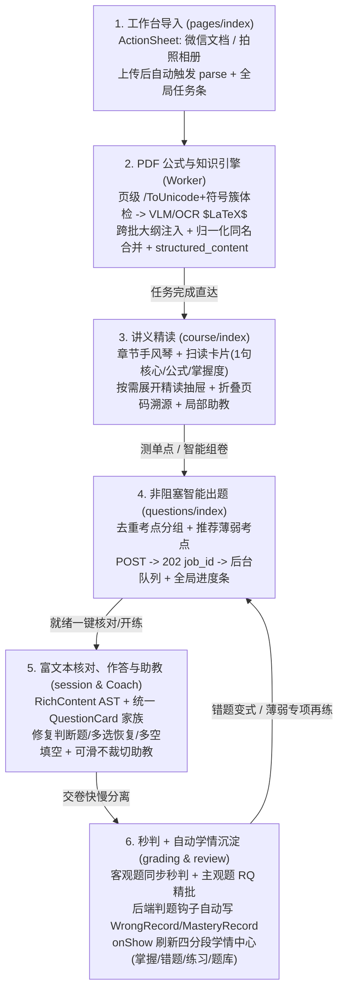

# 学习全流程重设计与移动端体验重构 — 核查综合与决策报告

## Executive Summary

对三份专项调研报告（`01`、`02`、`03`）执行源码逐行复核与活库/编译产物交叉验证后，**全部 6 类现场痛点均已锁定可复现根因**，并收敛为一条向后兼容的全链路重设计方案：

1. **UI1 蒙版糊屏、毛玻璃闪烁与 `showLoading` 告警**：`modal.scss:10,25` 将 `backdrop-filter: blur(2px)` 挂在含内容面板的整屏父容器且 6 个浮层共用 `z-index: 999`；`common.scss:47` 底栏用 `blur(10px)` 无 `z-index`，而 `questions.scss:154` 无模糊。全仓 **11 处 `uni.showLoading`** 与 `request.ts:16,35,141,155,165` 自动 `showToast` 抢占微信单槽位原生提示，触发不配对告警与 Toast 误杀。
2. **UI2 AI 助教不可滚动、右裁切与裸 Markdown**：`CoachMessageList.json` 缺 `virtualHost: true`、`.chat-body`（`CoachMessageList.vue:59-63`）缺 `height: 0; min-height: 0` 与滚底锚点；`App.vue:103` 全局 `box-sizing: border-box` 漏掉 `scroll-view` 与 `textarea`，使 `.chat-body` 宽变为 `750rpx + 64rpx = 814rpx`，右对齐气泡被裁切 32rpx；`useCoachChat.ts:26` 单列表跨上下文串台，正文直出裸 Markdown/LaTeX。
3. **UI3 PDF 公式乱码与知识点失焦/重复**：活库 `贝叶斯分类器.pdf` 第 6/7/11 页 `SymbolMT` 缺失 `/ToUnicode` CMap，`core/extractors.py:69-90,209` 跳过 OCR，`ocr_quality.py:44-46` 对 `AB&A&`/`"#$"$` 误判 `gibberish_ratio=0.000`，连带导致 `3/9` 新题触发 `NO_SOURCE` 降级；`services/knowledge.py:250,286` 降级切批（20 条/批）缺大纲上下文且 `knowledge_tree.py:86-151` 缺归一化同名合并（实测两枚 `朴素贝叶斯分类器` 余弦仅 `0.8537 < 0.92`），全库共 **9 组同名重复考点**，且 `KnowledgePoint` 只有扁平长文本。
4. **流程断裂 1 — 生题阻塞全站 15s 超时**：`POST /questions/generate`（`api/v1/questions.py:120`，及全站 **66 个 `async def` 路由**）在主事件循环同步调用 `Session` + `httpx.Client` + `time.sleep`，7 考点实测卡死 `uvicorn` **~101–105s**（`batch_b44cc12c2bdd` 首尾落库间隔 `89.18s`），直接拖死首页 `GET /materials`（15s 超时）。
5. **流程断裂 2 — 题目排版错乱与高危跨端 Bug**：除 PDF 乱码直出和缺富文本外，复核确认 **4 个跨层硬伤**：(a) `_question_llm_schemas.py:67-72` 字典选项未剥离 `A.` 前缀致 `A. A.` 双前缀；(b) `session/index.vue:166-172` 判断题传 `'A'/'B'`，而 `grading.py:91-96` 仅认 `正确/错误/T/F`，致**判断题恒判 0 分**；(c) `schemas/practice.py:25-46,461-462` 返回多选 JSON 串 `'["C"]'`，前端 `adapters/practice.ts:61-65` 未 `JSON.parse` 致续练丢答案；(d) `QuestionPreviewCard` 隐去答案/解析/采分点、`WrongRecordCard.vue:41-44` 错把题型显示为考点名。
6. **流程断裂 3 — 作答后学情界面空白**：活库实测交卷后 `diagnosis_reports`、`wrong_records`、`mastery_records` 已入库且 API 正常，但 `pages/review/index.vue:195` 与 `QuestionBankSection.vue:122` **缺失 `onShow` 刷新**（Tab 页常驻内存）且 `catch` 静默吞错；同时后端 `grading.py:174-314` 不写错题/掌握度，强依赖用户停在报告页等 `POST /diagnosis` 触发，提前离开或 `partially_graded` 即彻底断链。
7. **重设计愿景**：保留 8 页面 3-Tab 路由契约，重构为「**自动解析 + 后台非阻塞任务托盘 → 章节手风琴/结构化知识精读卡 → 异步出题 + 富文本核对/作答/助教 → 交卷客观秒判 + 后台精批自动沉淀错题与掌握度 → `onShow` 驱动的四分段学情中心**」。

---

## 1. Verified Root-Cause Matrix

> 注：所有源码锚点与统计数值均已在只读复核轮对照真实文件与活库验证；顺带修正了调研 `01` 一处路径笔误：`questions.scss` 实际路径为 `miniprogram/src/subpackages/material/questions.scss`。

| 痛点域 | 现场症状 / 截图 / 日志 | 已验证代码根因 (`file:line`) | 活库 / 编译产物实证 |
| :--- | :--- | :--- | :--- |
| **UI1** | 二级弹窗/抽屉模糊、出题页底栏毛玻璃时有时无、控制台报 `showLoading 与 hideLoading 必须配对使用` | `miniprogram/src/styles/modal.scss:10,25`（父遮罩挂 `blur(2px)` 且 6 浮层同为 `z-index: 999`）；`common.scss:47`（`.bottom-fixed-bar` `blur(10px)` 无 `z-index`）；`subpackages/material/questions.scss:154-164`（无 `blur` 无 `z-index`）；`course/index.vue:80-88` 同 tick 切换双 `blur` 浮层；**11 处 `showLoading`** 撞车 `utils/request.ts:16,35,141,155,165` 自动 `showToast`，且 `questions/index.vue:110-121` 正常空数据先 `showToast` 后 `finally { hideLoading }`，`pages/index/index.vue:151-156` 无 `try/finally` | `dist/build/mp-weixin` 6 份组件 `.wxss` 含 `blur(2px)`、15 份含 `blur(10px)`；`request.ts` 失败自动抢占原生 Toast 槽位 |
| **UI2** | AI 助教无法上下滑、右侧提问气泡被屏幕右边缘裁切、回复裸露 `**加粗**` 与公式、切换考点串台 | `CoachMessageList.vue:59-63`（`.chat-body` 仅 `flex: 1; overflow-y: auto` 缺 `height: 0; min-height: 0` 及 `:scroll-into-view`）；`App.vue:103-105`（`box-sizing: border-box` 漏 `scroll-view`/`textarea`，致 `.chat-body` 实际宽 `100% + 64rpx = 814rpx`）；`useCoachChat.ts:26` 单 `messageList` 未按上下文隔离；`CoachMessageList.vue:10` 直出 `<text>` | `dist/build/mp-weixin/components/CoachMessageList.json` 仅 `{"component": true}`（无 `virtualHost: true`），`<coach-message-list>` 宿主阻断 Flex 高度传导 |
| **UI3a** | PDF 切片出现 `AB&A&`、`"#$"$`、`!" ! #` 等符号乱码，导致下游出题降级 | `backend/app/core/extractors.py:69-90,209-210`（PDF 仅 `pypdf` 抽文本且只判非空字数 `< 10`）；`services/material.py:383-419`（仅图片走 OCR）；`core/algorithms/ocr_quality.py:44-46`（`VALID_PRINTABLE_CHAR_PATTERN` 将全部 ASCII 标点/字母算作有效字） | MinIO 实测 `贝叶斯分类器.pdf` 第 6/7/11 页为 `SymbolMT` + `/MacRomanEncoding` + `has_ToUnicode: False`；23 条切片 `gibberish_ratio=0.000`；`batch_b44cc12c2bdd` 中 **3/9 题**因乱码触发 `NO_SOURCE`（重合率 `0.167~0.214 < 0.30`） |
| **UI3b** | 知识点 15 行大段文字墙无重点分级；出题页出现两个同名 `朴素贝叶斯分类器` 胶囊 | `models/knowledge.py:64-92` 与 `knowledge_tree.py:24-39` 仅单 `description` 字段；`services/knowledge.py:150-157` 未约束结构；`services/knowledge.py:250,286` 重试缩批 `batch_size=20` 切分 23 切片为两批且无大纲传递；`knowledge_tree.py:86-151` 缺同名合并且用 `name + description` 过长文本算向量（`0.92` 阈值）；`KnowledgePointList.vue:8-23` 平铺展示 | 活库两枚 `朴素贝叶斯分类器`（274 字 vs 52 字）用 `BAAI/bge-m3` 实测余弦 **`0.8537 < 0.92`**；全库 5 份活跃资料中有 4 份存在重复考点（**共 9 组**）且 5/5 均为 `is_low_confidence=True` |
| **断裂 1** | 点击生题后切回首页，`GET /materials` 报 15s 超时，后台无感知 | `backend/app/api/v1/questions.py:120` 标为 `async def` 却同步调用 `QuestionService`、`Session`（`container.py:102-116`）和同步 `httpx.Client` + `time.sleep`（`llm/openai.py:118-155`、`embedding/openai.py:109-137`）；`services/question.py:476-491` 对 7 考点严格串行。`api/v1/*.py` 扫出 **66 个 `async def`** vs 仅 5 个 `def` | 活库 `batch_b44cc12c2bdd` 从第 1 题到第 9 题落库间隔 **`89.18s`**（总耗时 `~101–105s > LONG_REQUEST_TIMEOUT_MS=90000`），`uvicorn` 事件循环完全卡死致 `GET /materials`（`15000ms` 超时）失败 |
| **断裂 2** | 题目排版错乱（双前缀、公式挤团、缺答案/解析、判断题/多选题/填空题缺陷） | `_question_llm_schemas.py:67-72`（dict 选项不剥前缀致 `A. A.`）；`session/index.vue:166-172` 判断题写 `'A'/'B'` vs `grading.py:91-96,343-357` 仅认 `正确/错误/T/F`；`schemas/practice.py:25-46,461-462` 返回 `'["C"]'` vs `adapters/practice.ts:61-65` + `stores/practice.ts:102` + `session/index.vue:182-185`（`Array.isArray` 恒假）；`QuestionPreviewCard.vue` 无 `.q-options`/答案/解析；`AttemptResultCard.vue` 漏 `gradingPoints`；`WrongRecordCard.vue:41-44` `.kp-tag` 绑题型名 | 活库 `questions` `stem`/`options`/`answer` JSON 结构完整（无截断），乱码仅源于 `source_snippet` 与未排版公式如 `P(x•j=vl\|Y=ck)`；实库 `attempt_items.user_answer` 存 `'["C"]'` |
| **断裂 3** | 随便答题后「学情」Tab 界面空白；`report/detail` 仅能返回工作台 | `pages/review/index.vue:98-99,180-197` & `QuestionBankSection.vue:73,122-125`（**仅 `onMounted` 无 `onShow`** + 静默 `catch`）；`services/grading.py:220-314` 判完不写 `WrongRecord`/`MasteryRecord`，仅 `services/diagnosis.py:494-531` 在全卷 `completed` 且前端调 `POST /diagnosis` 时落库（`partially_graded` 在 `diagnosis.py:432-447` 直接抛 `40016` 阻断）；前端从未接 `GET /mastery` / `GET /diagnosis/reports` | 活库实测用户 `a7be4fd8-...` 交卷后 `deploy-worker-1` `0.338s` 判完，库内已有 `diagnosis_reports(1)`、`wrong_records(6)`、`mastery_records(5)`，4 个学情 API 均返回非空；但若之前打开过学情 Tab 切回不触发任何请求 |

*附带已验证体验断点*：`useMaterialUpload.ts:35-51` 在 `#ifdef MP-WEIXIN` 分支调用 `wx.chooseMessageFile` 后直接 `return`，阻断手机拍照/相册上传（与 `retake_required` 引导矛盾）；`useComposeConfig.ts:30-46` 默认全选全部考点并按 `max(selectedKpIds.length, questionCount)` 静默放大题量。

---

## 2. End-to-End Product Flow Redesign Architecture

保持现有 **8 页面 + 3-Tab（工作台 / 学情 / 我的）** 路由边界与 `docs/DESIGN.md` 温润学术纸质风，构建真正闭环的六段式非阻塞学习流：

### 2.1 Layer-by-Layer Redesign Blueprint

1. **资料解析与公式重建层（Backend）**：
   - **PDF 字体与符号簇双检**：`core/extractors.py` 改为按页返回 `PdfPageExtraction`；检测 `/Font` 缺失 `/ToUnicode`（如 `SymbolMT` + `/MacRomanEncoding`）或 `ocr_quality.py` 新增连续数学符号簇（`[!"#$%&\'*=?@^~]{2,}`）/ 孤立高标点行规则，命中页码渲染为高清 PNG，优先走视觉大模型（VLM）输出「中文 + `$LaTeX$`」，无 VLM 时降级 OCR + 文本 LLM 上下文修复，并保留 `page_number` 写入切片 `source_info`。
   - **PPT 噪音清洗**：`material_chunking.py` 清洗 Wingdings 伪列表符（`l `/`n `/`ü ` → `- `）及孤立页码残行。
2. **结构化知识模型与去重树（Backend + Course UI）**：
   - **向后兼容数据模型**：`knowledge_points` 新增 `structured_content: JSONB`（`core_summary`, `key_takeaways`, `key_formulas`, `exam_role`, `common_pitfalls`）、`importance`、`sort_order`；保留 `description` 存 `<=60` 字核心摘要。
   - **两阶段去重与跨批大纲**：`services/knowledge.py` 对 `batch_idx > 0` 注入已建 `{temp_id, name, level}` 骨架；`deduplicate_candidate_points` **前置确定性归一化同名合并**（`norm_name` 相同即合并切片/要点/公式并重定向 `parent_temp_id`），再对 `name + core_summary` 做向量语义去重；调优短 PPT 讲义的 `knowledge_quality.py` 误杀阈值。
   - **移动端三级精读 UX（`KnowledgePointList` 重构）**：章节手风琴目录（默认展开第 1 章或含薄弱点章）→ 紧凑扫读卡（层级 + 考点名 + 掌握度胶囊 + `<=2` 行 `core_summary` + 公式/易错徽标 + 「精读 / 测这一条」）→ 精读详情抽屉（`<RichContent>` 渲染核心结论/要点/公式/易错点 + 默认折叠的页码原文切片 + 助教/出题底栏）。
3. **非阻塞异步生题与全路由线程池保护（Backend + Global Task Tray）**：
   - **止血修正**：将 `backend/app/api/v1/*.py` 中调用同步 `Session`/`httpx` 的 **66 个 `async def` 路由**改为普通 `def`（仅读取 multipart/stream 保留必要异步），交由 `anyio` 线程池并发执行，彻底根除单请求卡死 `uvicorn` 事件循环。
   - **持久化异步任务流**：新增 `question_generation_jobs` 表与 RQ `generate_questions_job`（`zhilian_high` 队列），Worker 内部按考点可用受控线程池并发调 LLM/Embedding（`max_workers=3` 将 7 考点从 ~100s 压至 ~30s），逐考点更新 `completed_kps` 后单事务原子落库。`POST /questions/generate` 默认异步返回 `202` + `job_id`（保留同步模式兼容测试或低题量）；前端新增全局 `useBackgroundTaskStore` + 吸顶紧凑任务条，支持切回首页/逛讲义时实时感知「解析中 / 出题中 4/7 考点」，就绪后一键直达核对。
4. **富文本统一渲染、题型/判题修复与 AI 助教重构（Cross-Layer + Frontend）**：
   - **零依赖 `<RichContent>` 管线**：`src/utils/richText.ts` 将 Markdown（标题/加粗/列表/代码块/引用）与数学公式（`$...$`/`$$...$$`/希腊字母/算符/`\frac{A}{B}`→`(A)/(B)`/`_{}`→``/`^{}`→``）编译为微信小程序原生 `<rich-text :nodes>` JSON AST，彻底消灭裸符号与包体膨胀风险。
   - **统一 `QuestionCard` 家族与 4 大跨层修复**：
     1. `_question_llm_schemas.py` 对 `dict` 选项也剥离 `A.`/`A、`/`(A)` 前缀；
     2. `session/index.vue` 判断题提交 `'正确'` / `'错误'`（兼容展示历史 `'A'/'B'`）；
     3. `schemas/practice.py` 或 `adapters/practice.ts` 对 `multiple_choice` 执行 `JSON.parse` 还原 `string[]`，修复续练丢勾选；
     4. 填空题按参考答案分号拆出多格输入框，`QuestionSnapshotDTO` 补 `knowledge_point_name`，`QuestionPreviewCard` 增加可折叠「答案/解析/采分点」，`AttemptResultCard` 补充选项正误标、`gradingPoints` 及异常乱码切片折叠警示。
   - **AI 助教抽屉重构**：`CoachMessageList.vue` 开启 `virtualHost: true`、外包 `flex: 1; min-height: 0; overflow: hidden` 容器 + `scroll-view`（`height: 100%; box-sizing: border-box;`）+ `:scroll-into-view` 自动滚底；`App.vue:103` 补全 `scroll-view, textarea { box-sizing: border-box; }`；`useCoachChat` 按 `sessionKey`（`q:`/`kp:`/`mat:`/`folder:`）隔离会话缓存，增加可折叠单行上下文胶囊、破冰引导芯片、多行 `auto-height` `<textarea>` 与「复制解析 / 失败重发」。
5. **视觉层级、Loading 卫士与自动学情闭环（Visual + Grading + Review）**：
   - **零 `backdrop-filter` 视觉体系**：移除 `modal.scss` 与 `common.scss` 全部 `backdrop-filter`，改用暖墨色纯色 Scrim（`rgba(28,25,23,0.42~0.48)`）+ 实色纸白面板 + 统一 `--z-*` Token 阶梯（`--z-sticky: 20` / `--z-bottom-bar: 40` / `--z-fab: 60` / `--z-sheet-primary: 200` / `--z-sheet-coach: 300` / `--z-modal: 400`），彻底根除模糊与闪烁。
   - **`loadingGuard` 规范**：列表筛选与首刷禁用全屏 `uni.showLoading`（改用页面骨架/局部加载）；写操作统一走 `withBlockingLoading` 引用计数卫士（`finally` 先确保 `hideLoading` 再弹 Toast，并与 `request.ts` `silentToast` 协调），100% 清零 `showLoading` 配对告警。
   - **交卷快慢分离 + 自动沉淀 + 四分段学情中心**：`POST /practices/{id}/submit` 事务内同步秒判全卷客观题并立即落库局部错题/掌握度，仅主观题投递 RQ Worker；将 `DiagnosisService.sync_practice_learning_state(..., partial_ok=True)` 挂载到 `submit_practice`（全客观题）、`grade_practice`、`regrade_attempt`、`self_evaluate_attempt` 四个后端出口（Worker `completed` 时自动预生成 `DiagnosisReport`）。`pages/review/index.vue` 改用 `onShow` 刷新并暴露错误重试态，接入 `GET /mastery` 仪表盘与课程筛选，重构为「顶部总览（含判题中横幅）+ 四分段 Tab（`掌握地图 | 错题本 | 练习记录 | 我的题库`）」。

---

## 3. Key Product & UX Design Choices for User Alignment

以下 **3 项核心设计抉择** 存在真实产品取舍，建议在进入 Phase 2 编码前与用户拍板确认：

### Decision 1：PDF 数学公式页面重构引擎（VLM 视觉直出 `$LaTeX$` vs 传统 OCR + 文本大模型修复）
- **背景**：`贝叶斯分类器.pdf` 等 PPT 导出 PDF 的 `SymbolMT` 缺 `/ToUnicode` 映射，必须按页转图重识别（仅对异常页触发，如 29 页中约 6–8 页）。
- **方案 A（推荐）：按页渲染 PNG → 调用视觉多模态模型（VLM）直出「中文 + `$LaTeX$`」；未配置 VLM Key 时自动降级到 `OCR + 文本 LLM` 修复**。
  - *优点*：对矩阵、分式、条件概率连乘等二维公式还原率远高于纯行文本 OCR，能根治下游 `NO_SOURCE` 误杀。
  - *代价*：异常页每页增加 1 次 VLM 调用（~2–4s/页，可并发）；需确认 `backend/.env` 当前 API 供应商是否支持 Vision 模型（若不支持将自动走降级通道）。
- **方案 B：仅用现有百度 OCR + 文本 LLM 上下文猜补公式**。
  - *优点*：零新增多模态模型配置。
  - *代价*：传统 OCR 常把上下标与分式压扁成错序字符串，复杂概率公式仍可能二次失真。

### Decision 2：移动端学情中心与知识精读的信息架构（方案 B 渐进重构 vs 方案 A 轻量补丁 vs 方案 C 拆改 TabBar）
- **方案 A（轻量补丁）**：保留现有文字墙与纵长瀑布流，仅加 `onShow`、修 Bug 与截断 3 行文本。工期最短（2–3 天），但无法解决手机端扫读难与学情大瀑布流问题。
- **方案 B（推荐：保留 8 页 3-Tab 框架，内部全面模块化重构）**：
  - 讲义详情页升级为「章节手风琴 + 2 行精读卡 + 详情抽屉」；
  - 学情页升级为「顶部掌握度仪表盘 + 四分段 Tab（`掌握地图 | 错题本 | 练习记录 | 我的题库`）」；
  - 跨页新增全局非阻塞「后台任务进度条」。
  - *优点*：不破坏既有路由跳转、分包体积（主包 `<=2MB`）与 `<=300` 行单文件红线，同时完整解决全部 6 类体验痛点。
- **方案 C（重型仪表盘拆 Tab）**：将 TabBar 扩为 4–5 个（独立题库 Tab / 独立课程主页）。研发周期翻倍且易撞包体与现有测试体系。

### Decision 3：异步生题与交卷后学情沉淀的体验策略（彻底非阻塞 + 部分判题即刻沉淀 vs 严格整卷完结才记错题）
- **生题节奏**：
  - **推荐**：提交出题立即返回 `job_id` 并切入后台全局任务条（用户可返回工作台或浏览讲义，完成即提示跳转核对）；同时默认不再全选全部考点，当考点 `> 5` 时智能推荐「未掌握/薄弱考点（最多 5 个）」避免一上来生成 15–20 题。
  - *备选*：保留当前页等待进度条（允许返回但主按钮默认留在出题页看进度动画）。
- **错题与掌握度写入时机**：
  - **推荐（「先记已判项」`partial_ok=True`）**：交卷先同步秒判客观题并立刻写入客观错题与局部掌握度，主观题由 RQ 后台精批完成后增量合并；即便某道主观题降级 `partially_graded`，用户去学情页也能**立刻看到已错的客观题与待精批提示**。
  - *备选*：仅当整卷 `completed` 时才写错题与掌握度（保持 `partially_graded` 绝对干净，但用户主观题超时时会误以为整份试卷都没记录）。

---

## 4. Proposed Milestone Split (Phase 2 Non-Colliding Waves)

按「后端契约与数据底座 → 前端基础渲染与交互底座 → 页面业务闭环集成 → 全量门禁验收」切分为 4 个互不踩文件的并行波次：

### Wave 1：后端底座修复、异步队列与结构化知识升级（可 3 路并行）
- **Stream 1A — 全站线程解阻塞 + 异步生题队列**
  - 范围：`backend/app/api/v1/*.py`（66 个同步阻塞路由 `async def` → `def`）、`backend/app/models/question.py`（新增 `QuestionGenerationJob` 及 Alembic 迁移）、`backend/app/schemas/question.py`、`backend/app/repositories/question.py`、`backend/app/integrations/queue/protocol.py`、`backend/app/worker.py`、`backend/app/services/question.py`、`backend/app/api/v1/questions.py`。
  - 产出：非阻塞 `POST /questions/generate`（`202` + `job_id`）与 `GET /questions/jobs/{job_id}` / `GET /questions/jobs?active_only=true`，Worker 内受控并发提速。
- **Stream 1B — PDF 公式防乱码链路 + 结构化知识点与去重**
  - 范围：`backend/app/core/extractors.py`、`backend/app/core/algorithms/{ocr_quality,material_chunking,knowledge_tree,knowledge_quality}.py`、`backend/app/integrations/ocr/*`、`backend/app/models/knowledge.py`（Alembic 新增 `structured_content` / `importance` / `sort_order`）、`backend/app/schemas/{knowledge,folder}.py`、`backend/app/services/{material,knowledge}.py`。
  - 产出：页级 CMap/ASCII 符号簇检测 → 转图 VLM/OCR `$LaTeX$` 恢复、PPT 列表符清洗与页码留存；跨批大纲传递 + 确定性同名合并 + 结构化考点字段。
- **Stream 1C — 交卷快慢分离、自动沉淀钩子与题目契约补齐**
  - 范围：`backend/app/services/{practice,grading,_grading_llm,diagnosis,_question_llm_schemas}.py`、`backend/app/schemas/{practice,diagnosis}.py`、`backend/app/repositories/diagnosis.py`、`backend/app/api/v1/diagnosis.py`。
  - 产出：交卷同步秒判客观题 + 后台主观精批；4 入口自动调用 `sync_practice_learning_state`；Worker `completed` 自动预生成报告；修复 `_normalize_llm_options` dict 前缀剥离；补齐 `PracticeSummaryResponse`（`score_rate`/`folder_name`）、`QuestionSnapshotDTO.knowledge_point_name`、`WrongRecordItemResponse` 考点/资料名、`GET /mastery` 课程筛选，以及多选 `user_answer` 与判断题真假兼容。

### Wave 2：前端视觉底座、富文本渲染与助教/任务组件（可 3 路并行，依赖 Wave 1 契约定稿）
- **Stream 2A — 视觉层级重构与 Loading 卫士**
  - 范围：`miniprogram/src/App.vue`（`--z-*` Token + 补全 `scroll-view, textarea` `box-sizing`）、`miniprogram/src/styles/{modal,common}.scss`（彻底清零 `backdrop-filter`）、`miniprogram/src/utils/{loadingGuard,request}.ts`（`withBlockingLoading` + `silentToast`）。
- **Stream 2B — 零依赖 AST 富文本、统一 `QuestionCard` 与跨端适配器修复**
  - 范围：`miniprogram/src/utils/richText.ts`、`miniprogram/src/components/RichContent.vue`、`miniprogram/src/components/QuestionRichBody.vue`、`miniprogram/src/api/adapters/{question,practice,knowledge,wrong}.ts`、`miniprogram/src/api/modules/{diagnosis,questions}.ts`、`miniprogram/src/types/*.ts`。
  - 产出：Markdown + `$LaTeX$`/`sub`/`sup`/希腊字母安全 AST 渲染；多选 `JSON.parse` 修复、选项去重前缀、乱码切片检测折叠器、新 `structured_content` 与 `mastery`/`jobs` 类型适配。
- **Stream 2C — AI 助教重构与全局后台任务托盘**
  - 范围：`miniprogram/src/stores/backgroundTask.ts`、`miniprogram/src/components/BackgroundTaskBar.vue`、`miniprogram/src/composables/useCoachChat.ts`、`miniprogram/src/components/{AiCoachDrawer,CoachMessageList}.vue`。

### Wave 3：8 页面闭环集成（依赖 Wave 2 共享组件，按页面互斥并行）
- **Stream 3A — 工作台导入流 + 讲义结构化精读页**
  - 范围：`miniprogram/src/pages/index/**`（ActionSheet 拍照/文档上传、上传自动解析、全局任务条、FAB 防遮挡）、`miniprogram/src/subpackages/material/{pages/course/**,composables/useCourseDetail.ts,components/{KnowledgePointList,KnowledgeSnippetModal}.vue}`（章节手风琴 + 扫读卡片 + 详情抽屉）。
- **Stream 3B — 异步出题核对 + 沉浸多题型作答 + 报告页双入口**
  - 范围：`miniprogram/src/subpackages/material/{pages/questions/**,composables/useComposeConfig.ts,composables/useQuestionCompose.ts,components/{QuestionConfigPanel,QuestionPreviewCard,QuestionPreviewPanel}.vue}`、`miniprogram/src/subpackages/practice/**`、`miniprogram/src/subpackages/report/**`。
- **Stream 3C — `onShow` 驱动的分段学情中心**
  - 范围：`miniprogram/src/pages/review/**`（`onShow` 刷新 + 三态错误重试 + 顶部 `GET /mastery` 仪表盘 + `掌握地图 | 错题本 | 练习记录 | 我的题库` 分段 Tab + `WrongRecordCard` / `PracticeEntryCard` / `QuestionBankSection` 重构）。

### Wave 4：离线/全量质量门禁与真实端到端回归
- 宿主 Windows PowerShell 执行 `task verify`（`ruff`、`mypy`、`lint-imports`、`pytest --cov=app --cov-branch --cov-fail-under=80`、`eslint`、`vue-tsc`、`vitest`）+ `pnpm run build:mp-weixin` + 真实上传 PDF（含公式页）→ 结构化精读 → 异步出题 → 作答含判断/多选/填空/简答 → 交卷 → 学情中心与 AI 助教全链路验真。

---

## 5. Consolidated `.trellis/spec/` Paths (For Phase 2 Curation)

- **Guides**:
  - `D:/code/Workspace/zhilian/.trellis/spec/guides/index.md`
  - `D:/code/Workspace/zhilian/.trellis/spec/guides/cross-layer-thinking-guide.md`
  - `D:/code/Workspace/zhilian/.trellis/spec/guides/code-reuse-thinking-guide.md`
  - `D:/code/Workspace/zhilian/.trellis/spec/guides/git-and-workspace-governance.md`
- **Backend**:
  - `D:/code/Workspace/zhilian/.trellis/spec/backend/index.md`
  - `D:/code/Workspace/zhilian/.trellis/spec/backend/directory-structure.md`
  - `D:/code/Workspace/zhilian/.trellis/spec/backend/database-guidelines.md`
  - `D:/code/Workspace/zhilian/.trellis/spec/backend/error-handling.md`
  - `D:/code/Workspace/zhilian/.trellis/spec/backend/quality-guidelines.md`
  - `D:/code/Workspace/zhilian/.trellis/spec/backend/logging-guidelines.md`
  - `D:/code/Workspace/zhilian/.trellis/spec/backend/material-statistics.md`
- **Frontend**:
  - `D:/code/Workspace/zhilian/.trellis/spec/frontend/index.md`
  - `D:/code/Workspace/zhilian/.trellis/spec/frontend/directory-structure.md`
  - `D:/code/Workspace/zhilian/.trellis/spec/frontend/component-guidelines.md`
  - `D:/code/Workspace/zhilian/.trellis/spec/frontend/state-management.md`
  - `D:/code/Workspace/zhilian/.trellis/spec/frontend/hook-guidelines.md`
  - `D:/code/Workspace/zhilian/.trellis/spec/frontend/type-safety.md`
  - `D:/code/Workspace/zhilian/.trellis/spec/frontend/network-contract.md`
  - `D:/code/Workspace/zhilian/.trellis/spec/frontend/api-payload-contracts.md`
  - `D:/code/Workspace/zhilian/.trellis/spec/frontend/quality-guidelines.md`
- **Visual Design**:
  - `D:/code/Workspace/zhilian/docs/DESIGN.md`
