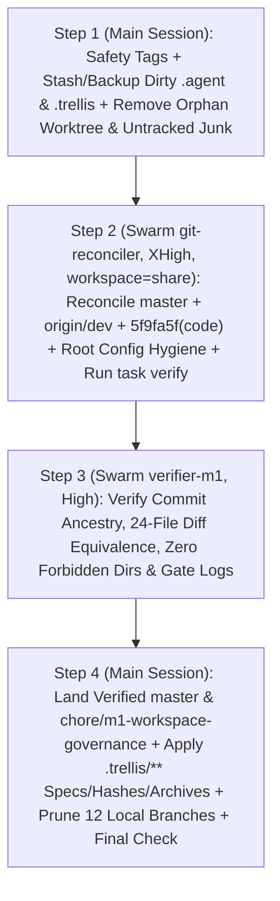

# Technical Design — M1: Git分支合流清理与工作区规范治理

## 1. Architecture & Ownership Boundaries

本里程碑同时涉及 **Git 分支拓扑重构**、**非 `.trellis` 工程配置清洗** 与 **`.trellis/**` 规范/任务治理**。根据 `AGENTS.md` 与 `.agent/hooks/trellis_agy_hook.py` 的硬性边界（**子代理严禁修改 `.trellis/**` 或执行 `git push`**），采用 **「主会话备份与 `.trellis`/Ref 收口 + 原生 `Swarm` 隔离工作树（`share`）合流验证」** 的协同架构：

### 角色与模型分级（遵循用户复杂度派发规则）
- **`git-reconciler`（Author，`workspace: "share"`，`model: "gemini-4-hydrogen-xhigh"`）**：处理 19 文件分叉合流、`5f9fa5f` 23 个非 `.trellis` 业务/测试文件剥离迁入、根配置清洗及全量 `task verify`（含 `origin/dev` 新增的 `diff-cover` 门禁验证），复杂度高，使用 `XHigh`。
- **`verifier-m1`（Verifier，`workspace: "inherit"`，`model: "gemini-4-hydrogen-high"`）**：核对提交树、文件差异完整性、目录残留与门禁结果，标准核验复杂度，使用 `High`。
- **`monitor`（Stall Monitor，`model: "gemini-4-hydrogen-high"`）**：复用现有 Swarm 巡检器防止协作停滞。

## 2. Branch Topology & 19-Path Conflict Resolution Design

### 2.1 目标分支拓扑（本地）
1. **`master`**：
   - 基线：`0c301fa` -> 快进合入 `origin/dev`（`10bdd91`，完整保留 21 个提交及标签 `midterm-baseline-2026-10-04` 所在祖先链） -> 叠加独立提交 `fix(profile): land learning statistics contract and UI (from 5f9fa5f)`（完整包含 `5f9fa5f` 的全部 24 个文件改动，含 `backend/app/{api,repositories,schemas,services}/material*.py`、`miniprogram/src/pages/profile/**`、测试与 `.trellis/spec/backend/material-statistics.md`）。
   - 为什么这样排：`origin/dev` 自 `0c301fa` 起是纯前向演进（`0` behind `master`），直接 `git merge --ff-only origin/dev` 即可零冲突落入 `master`！此前之所以产生 19 个冲突路径，是因为 `chore/workspace-configs` 上的 `02c0840` 与 `origin/dev` 重复归档了相同的 `10-03-midterm-*` 任务并各自改写了 `.trellis/workspace/lls/journal-1.md` 与 `.gitignore`。以 `origin/dev` 为新 `master` 基底后，不再重放已被取代的混杂提交 `02c0840`，而是只精准提取 `5f9fa5f`（业务修复）和干净的工作区治理改动，从根源上消除全部 19 处伪冲突！
2. **`chore/m1-workspace-governance`**（从更新后的本地 `master` 切出）：
   - 承载本里程碑的工作区目录清洗、`.agent/`（Antigravity Trellis 集成）、更新后的 `AGENTS.md` / `.trellis/workflow.md` / `.trellis/.template-hashes.json`、`.gitignore`（补充 `.pi/`、`.worktrees/`、`delivery_lab5_6/`）、新增 `.editorconfig`、移除 `sync_to_host.sh`、修正 `.gitattributes`、归档 5 个已落地的 `09-29-*` 任务及新增 `.trellis/spec/guides/git-and-workspace-governance.md`。

### 2.2 AI 目录与工作区清理契约
| 路径 | 处置动作 | 原因 |
| --- | --- | --- |
| `.agent/`、`AGENTS.md` | **保留并纳入版本控制** | 当前 Antigravity + Trellis 核心运行钩子与技能 |
| `.agents/`、`.codex/` | **保留** | Codex 技能与自定义子代理配置 |
| `.trellis/` | **保留并清洗** | 移除 `.template-hashes.json` 中 `.opencode` 与 `__pycache__` 项；归档 5 个已完成 `09-29-*` 任务 |
| `.claude/` | **确保不进入分支并清理本地残留** | 用户已确认不再保留（注：`origin/dev` 上原本就不含 `.claude/`，仅 `02c0840` 引入） |
| `.opencode/`、`opencode.json` | **git rm 跟踪文件 + 删除本地 `node_modules/`** | 用户已确认清理（释放 3,667 个冗余文件与 55 个跟踪模板） |
| `.pi/`、`%SystemDrive%/`、`backend/.trellis/` | **删除本地目录** | 未跟踪本地残留/环境变量误展开产物/子目录误初始化空壳 |
| `sync_to_host.sh` | **`git rm` 移除** | WSL `/mnt/d/zhilian-mp` 脚本，违背 `AGENTS.md` 宿主直跑规范 |
| `.editorconfig` | **新建** | 统一 `charset = utf-8`、`end_of_line = lf`、`insert_final_newline = true`，根治 Windows CRLF 告警 |

## 3. Operational Safety & Rollback Considerations

1. **双保险本地归档标签**：
   - `archive/pre-m1-chore-workspace-configs` -> `d223cb5`
   - `archive/codex-frontend-vertical-slices` -> `51604a4`
   - 即使删除本地 `chore/workspace-configs` 与 `codex/frontend-vertical-slices` 分支，任何时刻均可通过 `git checkout -b <name> archive/...` 毫秒级无损回滚。
2. **未提交工作区改动保护**：
   - 当前工作区有未提交的 `.agent/`、`AGENTS.md`、`.trellis/workflow.md`、`.trellis/.template-hashes.json` 及 `.trellis/tasks/11-17-*`。在切换主工作区分支前，先将上述文件完整备份到会话专属暂存目录 `C:\Users\15262\.gemini\antigravity\brain\74e1e5b1-6345-458d-90f4-300c6531eb72\scratch\m1-backup\`，杜绝切分支时覆盖或遗失。
3. **严守 `.trellis/**` 子代理禁令**：
   - `git-reconciler` 在 `share` 工作树中仅操作非 `.trellis/**` 路径（应用 `5f9fa5f` 时排除 `.trellis/spec/backend/material-statistics.md`，由主会话在合并回主工作区时一并精确检出 `git checkout 5f9fa5f -- .trellis/spec/backend/material-statistics.md`）。
4. **门禁兼容说明**：
   - `origin/dev` 合入后，`Taskfile.yml` 包含 `diff-cover` 等中期增强检查；需在宿主 Windows `pwsh` 下实测 `task verify` 确认 `backend/.venv` 与 `miniprogram` 100% 通过。
